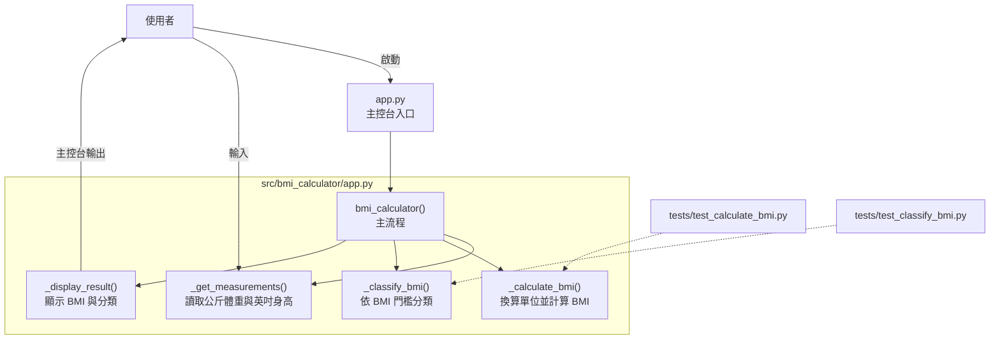
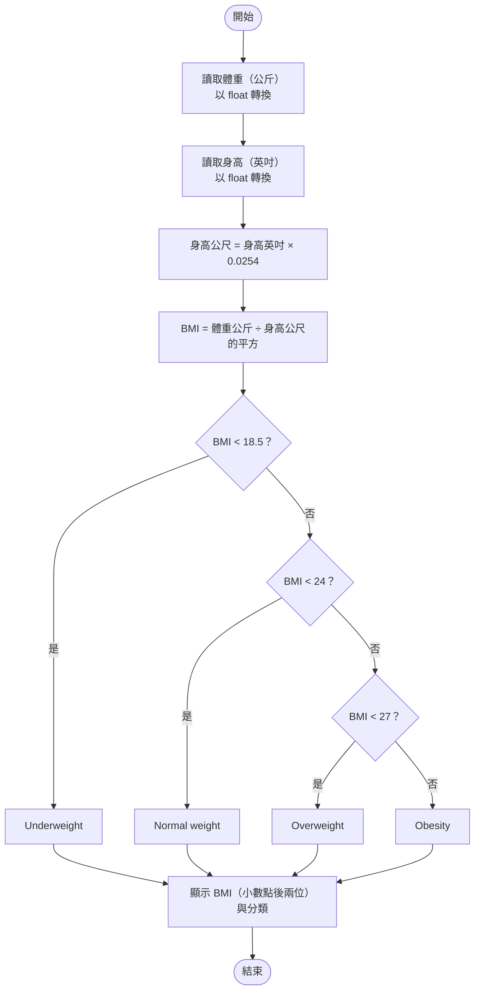
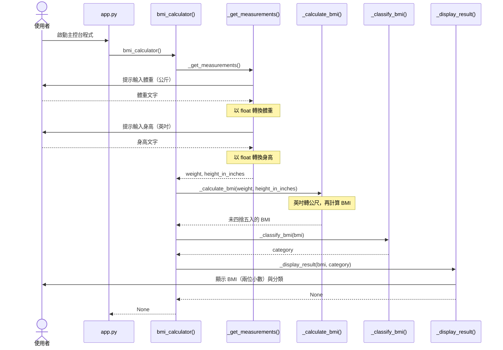

# TODO 示範網站與 BMI Calculator

## TODO Demo（.NET 8）

`TodoDemo/` 是使用 ASP.NET Core Razor Pages 建立的本機待辦事項網站，可新增、查看、
編輯、刪除 TODO，並切換完成狀態。資料會保存到 `TodoDemo/App_Data/todos.json`；
檔案會在第一次新增 TODO 時建立。

### 啟動網站

需要安裝 .NET 8 SDK。在儲存庫根目錄執行：

```sh
dotnet run --project TodoDemo
```

開啟終端機顯示的本機網址即可操作。按「新增」建立待辦事項；每筆事項可用圓形按鈕
切換完成狀態、「編輯」修改內容，或按「刪除」移除。標題必須為 1 至 120 個字元。

## BMI Calculator（既有範例）

以 Python 實作的主控台 BMI 計算器，使用 `src/` 套件佈局、uv 管理依賴，
並以 pytest 與 AssertPy 測試 BMI 計算及分類。

## 環境需求

- Python 3.10 以上。
- 已安裝 uv，安裝方式參考 <https://docs.astral.sh/uv/getting-started/installation/>。
- 本機需可存取 Microsoft 套件代理來源：
  <https://packagefeedproxy.microsoft.io/pypi/simple/>。

以下命令均在專案根目錄執行，不需手動啟用虛擬環境，也不會安裝到全域 Python。

## 專案結構

```text
.
├── app.py                         # 原有主控台入口
├── pyproject.toml                 # 套件、測試依賴與 pytest 設定
├── uv.lock                        # uv 產生的依賴鎖定檔
├── src/
│   └── bmi_calculator/
│       ├── __init__.py
│       └── app.py                 # BMI 實作
└── tests/
    ├── test_calculate_bmi.py       # BMI 計算測試
    └── test_classify_bmi.py        # BMI 分類測試
```

## 架構圖

根目錄的 `app.py` 是主控台入口，呼叫套件中的 `bmi_calculator()` 協調各個步驟。
下圖套件框內的節點都是同一個模組內的函式，不是獨立服務；虛線表示單元測試
直接呼叫被測函式，不經過主控台入口。



## 計算流程圖

以下呈現輸入有效正數時的正常流程。程式目前未提供輸入有效性驗證：
無法轉換為浮點數的文字會引發 `ValueError`，零身高會引發 `ZeroDivisionError`，
這些例外不會被主流程攔截，也沒有重新輸入的迴圈。



分類使用未四捨五入的 BMI；等於 18.5、24 或 27 時會進入下一個分類。
保留兩位小數僅影響顯示文字，不改變計算回傳值或分類結果。

## 主控台互動時序圖

下圖依根目錄入口的執行順序，呈現一次正常互動中各函式的呼叫與資料回傳。
參與者代表使用者、入口與模組內函式，並非網路服務或不同執行程序。



以上圖表使用 Mermaid 程式碼區塊，可直接在支援 Mermaid 的 Markdown 閱讀器
（例如 GitHub）中顯示；不支援的閱讀器則會顯示原始圖表語法。

## 安裝專案與測試依賴

```powershell
uv sync --locked --group test --default-index https://packagefeedproxy.microsoft.io/pypi/simple/
```

uv 會使用或建立專案的 `.venv`，依 `uv.lock` 安裝依賴，並以可編輯模式安裝
`src/bmi_calculator` 套件。請保留並一併版本控制 `pyproject.toml` 與 `uv.lock`。
依賴有意變更時，才執行下列命令更新鎖定檔；不要手動修改鎖定檔：

```powershell
uv lock --default-index https://packagefeedproxy.microsoft.io/pypi/simple/
```

## 執行測試

完整測試與詳細輸出：

```powershell
uv run --locked --group test --default-index https://packagefeedproxy.microsoft.io/pypi/simple/ pytest -vv -ra --tb=long --showlocals
```

`pyproject.toml` 已預設啟用這些詳細選項，因此也可省略 pytest 後面的選項。

| 選項 | 顯示內容 |
| --- | --- |
| `-vv` | 每個測試的檔案、函式名稱及通過／失敗狀態 |
| `-ra` | 非通過案例的摘要，例如失敗或略過原因 |
| `--tb=long` | 失敗時顯示完整 traceback 與相關程式碼 |
| `--showlocals` | 失敗時顯示相關區域變數，協助比較輸入與預期值 |

通過的測試不會逐行列印 Arrange／Act／Assert，這三個階段可在測試原始碼查看。
失敗細節只有在發生失敗時顯示；`--showlocals` 可能包含測試資料，分享輸出前請確認內容。

只執行 BMI 計算測試：

```powershell
uv run --locked --group test --default-index https://packagefeedproxy.microsoft.io/pypi/simple/ pytest tests/test_calculate_bmi.py
```

只執行一個分類案例：

```powershell
uv run --locked --group test --default-index https://packagefeedproxy.microsoft.io/pypi/simple/ pytest tests/test_classify_bmi.py::test_classify_bmi_at_24_as_overweight
```

## 測試範圍與 3A

僅測試 `_calculate_bmi` 與 `_classify_bmi`，不測試主控台輸入、輸出或主流程。
每個案例都是獨立的 `test_...` 函式，不使用參數化、迴圈或 mock：

1. **Arrange**：準備輸入與獨立的預期結果。
2. **Act**：呼叫一次被測函式。
3. **Assert**：使用 `assert_that(actual).is_equal_to(expected)` 進行流暢斷言。

| 測試類型 | 輸入 | 預期結果 |
| --- | --- | --- |
| BMI 計算 | 57 公斤、67 英吋 | BMI 四捨五入至兩位為 19.68 |
| BMI 分類 | 18.49 | `Underweight` |
| BMI 分類 | 18.5 | `Normal weight` |
| BMI 分類 | 23.99 | `Normal weight` |
| BMI 分類 | 24 | `Overweight` |
| BMI 分類 | 26.99 | `Overweight` |
| BMI 分類 | 27 | `Obesity` |

計算函式回傳未四捨五入的浮點數；測試在斷言階段四捨五入至兩位進行比較。

## 計算與分類規則

身高公尺 = 身高英吋 × 0.0254；BMI = 體重公斤 ÷ 身高公尺的平方。

| BMI 區間 | 分類 |
| --- | --- |
| 小於 18.5 | `Underweight`（體重過輕） |
| 大於等於 18.5 且小於 24 | `Normal weight`（正常體重） |
| 大於等於 24 且小於 27 | `Overweight`（過重） |
| 大於等於 27 | `Obesity`（肥胖） |

這些規則沿用既有程式，並非本次測試工作新增。程式未提供輸入有效性驗證，
請輸入有效的正數體重與身高；零身高會產生除以零錯誤。本次不擴充此行為。

## 執行主控台程式

完成環境同步後，仍可使用根目錄入口：

```powershell
uv run --locked --group test --default-index https://packagefeedproxy.microsoft.io/pypi/simple/ python app.py
```

依序輸入公斤體重與英吋身高。根目錄入口依賴已安裝的套件，
不要在尚未同步或未安裝此套件的其他 Python 環境直接執行。